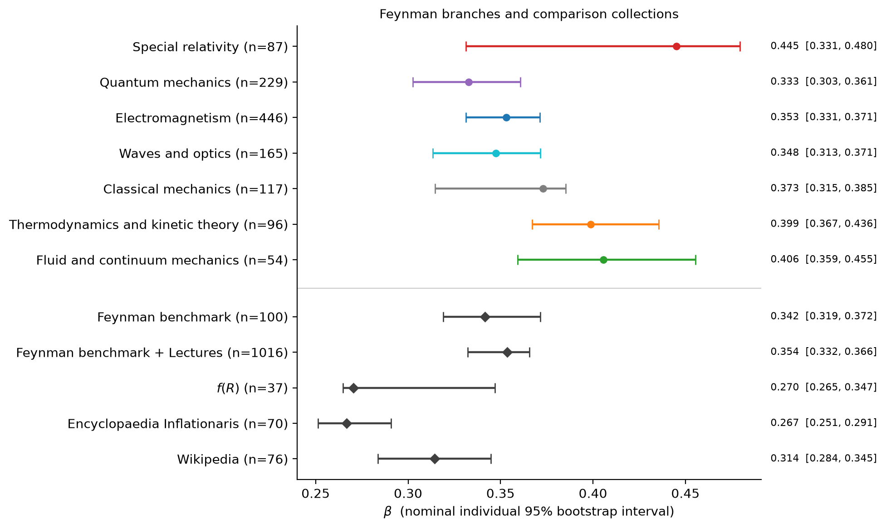

# Operator statistics and expression priors for symbolic regression in physics

<div align="center">

<a href="writeup/main.pdf"></a>
<a href="https://jaysen-ma.github.io/physics-metalaw/data/catalog/index.html"></a>

</div>

An ongoing personal research project examining variation in operator usage across physics collections and whether that variation can inform priors for symbolic regression.

> **Work in progress.** The symbolic regression study below is planned. The linked write-up covers the operator-frequency analysis and is still being revised.

## Research question

Previous work reported a different fitted operator-frequency decay rate for inflationary expressions than for broader physics collections. We reassess this gap and examine operator usage across physics branches. This motivates asking whether knowledge of a problem's branch can help symbolic regression find its equation.

We ask two questions:

1. **Does a physics prior help?** Compare a prior learned from the available physics branches with a generic baseline that uses no corpus information.
2. **Does knowing the branch help further?** Compare the pooled physics prior with one that gives greater influence to expressions from the relevant branch.

## Planned experiment

Choose a branch, such as thermodynamics. Hold out some equation families as test problems and use the remaining expressions to construct the priors:

| Prior | Training information and use |
|---|---|
| **Generic baseline** | Use no learned corpus information. |
| **A. Base** | Learn from the other physics branches. |
| **B. Pooled** | Learn from all available training expressions, ignoring branch labels. |
| **C. Branch-informed** | Use the same expressions as B, giving those from the target branch greater influence. |

B and C use exactly the same training expressions. Their difference is how much influence the relevant branch has on the learned prior.

**C versus B** tests whether knowing the branch helps. **B versus the generic baseline** tests whether learning a physics prior helps. **B versus A** measures the benefit of adding examples from the target branch.

Repeat the experiment with different branches as the target.

### Evaluation

We intend to construct a custom loss for PySR that incorporates the learned expression preferences. The loss and the method for giving the target branch greater influence remain to be determined.

All comparisons will use the same search settings and computational budgets. Test equations and related forms will be excluded from prior construction. Settings will be chosen using separate validation expressions.

We will compare equation recovery, prediction accuracy on new inputs, and search effort. Repeated datasets and search runs will measure variability, with results reported for each branch.

## Starting point: variation in operator frequencies

Ranked operator frequencies can be described approximately by an exponential law. Its decay rate $\beta$ measures how concentrated usage is among the most frequent operators. We fit this rate using **log least squares** and estimate individual intervals from **10,000 whole-equation bootstrap resamples**.



Circles show seven physics branches; diamonds show five comparison collections. Some collections share expressions.

The lower inflationary estimate is reproduced. Changes to constants and amplitude prefactors leave much of its difference from the Feynman benchmark intact, while the $f(R)$ collection has a similar fitted rate. Fitted rates also vary across the Feynman branches. These observations motivate the SR study; they do not establish that a learned prior improves search.

The analysis covers selected algebraic expressions and omits differential and integral forms. Representation, branch assignments and corpus selection affect the fits. Rare operators produce flat tails that the exponential model captures poorly, and the bootstrap intervals provide only approximate uncertainty.

## Data and formula ledger

The expanded Feynman collection contains 1,016 expressions after deduplication, with 968 assigned to seven branches. Other catalogues include Wikipedia equations, Encyclopaedia Inflationaris, 61 Leemis probability distributions and 37 proposed $f(R)$ curvature functions.

The [formula ledger](https://jaysen-ma.github.io/physics-metalaw/data/catalog/index.html) shows expressions, sources, counted trees and operator totals, including [per-expression statistics](https://jaysen-ma.github.io/physics-metalaw/data/catalog/index.html?page=beta).

## Using the repository

Run commands from the repository root. To prepare the environment for the catalogue and descriptive analysis:

```bash
python3 -m venv .venv
.venv/bin/python -m pip install -r requirements.txt matplotlib
```

Serve the formula ledger locally:

```bash
.venv/bin/python -m physics_metalaw.catalog --serve --port 8766
```

Then open `http://127.0.0.1:8766/`.

Run the exponential-fitting pipeline and its separate interval-calibration analysis:

```bash
.venv/bin/python scripts/exponential_bootstrap.py
.venv/bin/python scripts/exponential_coverage_check.py
```

SR reproduction instructions will follow once the experimental procedure is fixed.

## Data sources and attribution

- **The Feynman Lectures on Physics**, Vol. I–III, R. P. Feynman, R. B. Leighton and M. Sands, New Millennium Edition, © California Institute of Technology, [feynmanlectures.caltech.edu](https://www.feynmanlectures.caltech.edu/). Extracted expressions record their source equation, volume, chapter and section.
- **AI Feynman benchmark**: S.-M. Udrescu and M. Tegmark, *AI Feynman: a physics-inspired method for symbolic regression*, Science Advances 6, eaay2631 (2020), as distributed with [arXiv:2408.11065](https://arxiv.org/abs/2408.11065).
- **Wikipedia**, [List of scientific equations named after people](https://en.wikipedia.org/wiki/List_of_scientific_equations_named_after_people) (CC BY-SA 4.0); each expression links to its article.
- **Encyclopaedia Inflationaris**: J. Martin, C. Ringeval and V. Vennin, Phys. Dark Univ. 5–6, 75 (2014), [arXiv:1303.3787](https://arxiv.org/abs/1303.3787).
- **Leemis**: L. M. Leemis and J. T. McQueston, *Univariate distribution relationships*, The American Statistician 62, 45 (2008); [chart](https://www.math.wm.edu/~leemis/chart/UDR/UDR.html).
- **f(R)**: T. P. Sotiriou and V. Faraoni, *f(R) theories of gravity*, Rev. Mod. Phys. 82, 451 (2010), [arXiv:0805.1726](https://arxiv.org/abs/0805.1726), and papers cited per expression in the ledger.
